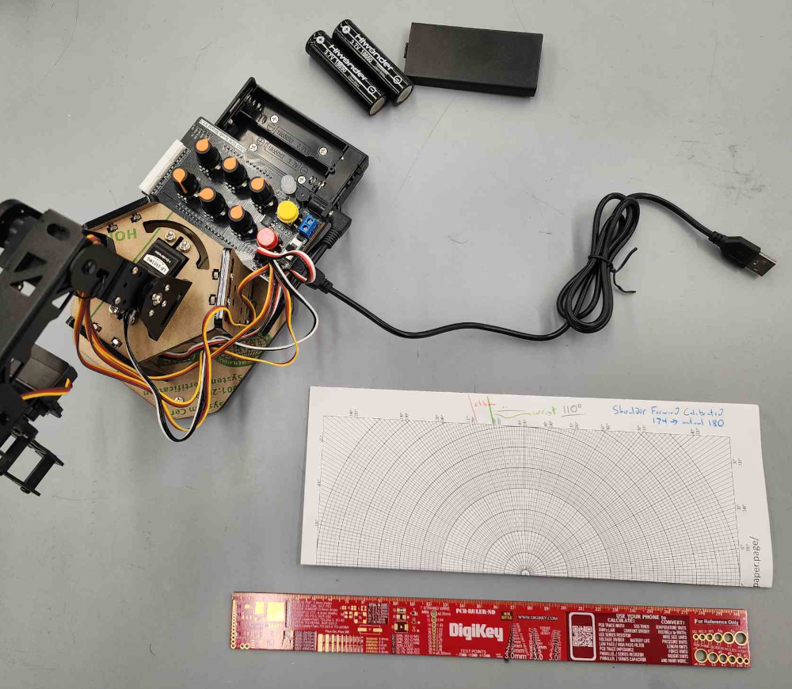
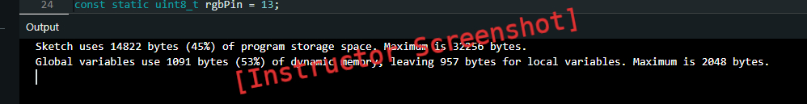
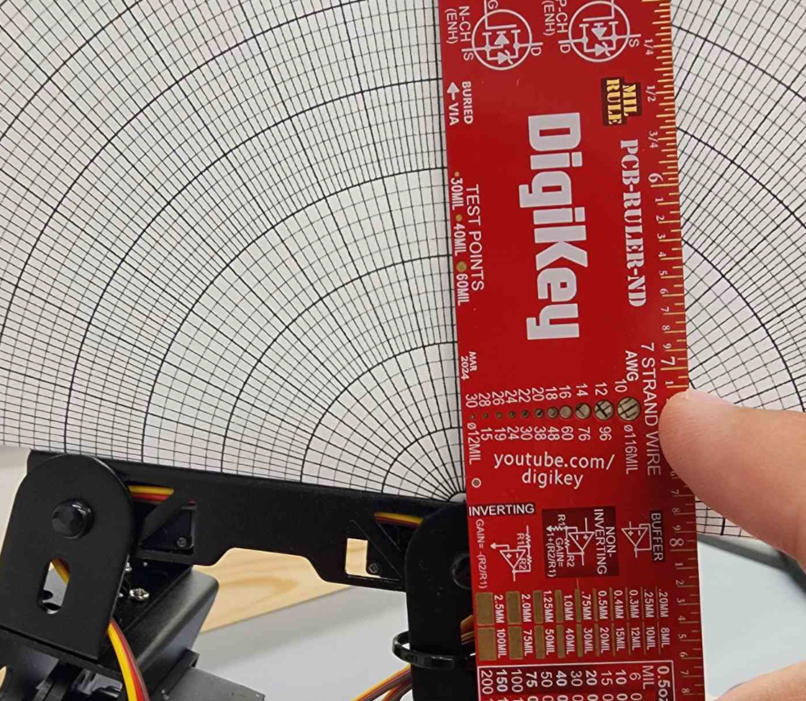

# Lab 00 — miniArm Setup and Firmware Verification

## Goal

**Get Hiwonder's default firmware running on your miniArm, confirm it starts up correctly, and map every knob to the joint it moves.**

Every later lab assumes this works. A wrong library, a skipped startup step, or a misidentified joint shows up later as a mystery failure, so this lab rules them out first.

## You're done when

- [ ] The default firmware compiles and uploads without errors.
- [ ] The arm starts in its midpoint pose and you can switch it to knob mode.
- [ ] Your joint table names the joint each knob moves, its direction, and its safe range.
- [ ] Your inventory records the hardware and software versions you used.

## Objectives

1.  Install the Arduino toolchain and upload the default miniArm firmware.
2.  Recognize the firmware's startup modes from the status light.
3.  Identify the five joints and their safe ranges of motion.
4.  Document the configuration so problems in later labs can be traced.

## Before you start

**Hardware:** Hiwonder miniArm with Arduino Uno, USB Type-B data cable, and the supplied power source. For joint mapping, a ruler and protractor provide best results, but a straightedge and printout of the polarCoordinates.pdf can get the job done.

**Safety:**

- Keep hands clear of the joints whenever the arm has power.
- Do not force a servo against a mechanical stop. If a servo buzzes or strains, back the knob off or switch the power off.
- Secure the arm and keep its work area clear.

## Part 1 — Install and upload (30 min)

> **Why this part matters:** The firmware only compiles with the right library versions. Following the tested setup exactly avoids the most common errors.

Complete sections 1–5 of the [repository setup guide](../README.md#arduino-uno-setup-and-default-firmware). When it is done, you should have:

- a successful Verify, with memory usage reported in the Output panel; and
- **Done uploading** after Upload.

Take a screenshot of the successful upload for your report. If anything fails, use the setup guide's [Troubleshooting](../README.md#troubleshooting) section and note what happened and what fixed it.

## Part 2 — Verify the startup modes (10 min)

> **Why this part matters:** The arm ignores the knobs until it leaves its startup pose. Knowing the status light tells you which mode the arm is in at a glance.

1.  Keep clear of the arm and switch the battery box on.
2.  The arm moves to its **midpoint pose**: every servo near its middle position, arm upright. The light is **white**.
3.  Press **K1 and K2 at the same time** and hold for about 2 seconds, until the light turns **bright green**. The arm is now in **knob mode**.

| Light | Mode |
| --- | --- |
| White | Midpoint pose at startup; knobs do nothing |
| Bright green | Knob mode; the knobs drive the servos |
| Blue | App or serial mode; a phone or computer is sending commands (used in Lab 03) |

**Press both buttons together.** Holding K1 alone for about 2 seconds at startup enters the **offset-adjust mode**, which also shows a dimmer green light. That mode is for calibration and can save new offsets for every servo. If you enter it by accident, see Troubleshooting.

## Part 3 — Map the joints (20 min)

> **Why this part matters:** Every later lab refers to the joints by knob and name. Finding each joint's safe range now protects the servos when you start commanding motion.

Turn each knob slowly, one at a time, from one end to the other. Fill in this table in your report:

| Knob | Joint | Clockwise knob -> joint direction | Stops or touches something at… | Safe range (describe both ends) |
| --- | --- | --- | --- | --- |
| S1  | claw |     |     |     |
| S2  | wrist |     |     |     |
| S3  | forearm |     |     |     |
| S4  | arm |     |     |     |
| S5  | base / pan |     |     |     |

For the direction column, use plain words such as "opens," "tilts down," or "turns left." For safe range, note where the joint hits the frame, the table, or another link, and stay a little inside that point.

Example: Keeping the link parallel to the polar paper, and ruler aligned with the previous link and origin of the polar paper, this forearm stops approximately 9 degrees off from being perpendicular with the previous arm linkage. Its clockwise knob direction is 'FORWARD', stopping 9 degrees early and has a full safe range of motion in both directions.

## Part 4 — Record your configuration (10 min)

> **Why this part matters:** When something breaks in a later lab, the first question is "what changed?" This record answers it.

Fill in this inventory:

| Item | Your value |
| --- | --- |
| Computer and operating system |     |
| Arduino IDE version |     |
| FastLED version |     |
| Servo library version |     |
| COM port |     |
| Bluetooth module present? |     |
| ESP32-S3-Cam present? |     |

## Deliverables

- Screenshot of the successful upload (Part 1)
- Short video of safe knob control, moving each joint once (Parts 2–3)
- Joint table (Part 3)
- Configuration inventory (Part 4)
- Troubleshooting notes: any problem you hit and how you fixed it

## Troubleshooting

For compile and upload errors, see the setup guide's [Troubleshooting](../README.md#troubleshooting).

| Problem | Check |
| --- | --- |
| Knobs do nothing after power-up | The arm is still in the midpoint pose (white light). Press K1 and K2 together until the light turns bright green. |
| Light turned dim green and the knobs move the arm, but the arm drifts off its midpoint pose | You entered offset-adjust mode by holding K1 alone. Do not press both buttons now: that saves new offsets. Switch the power off and back on, then press K1 and K2 together. |
| The arm no longer starts upright after someone pressed the buttons | Offsets were saved by accident. Ask your instructor to recalibrate before Lab 01. |
| A joint moves the wrong way compared with your neighbor's arm | Record it in your joint table. Arms can differ, and later labs depend on your own table. |

## References

Hiwonder *3.1 Default Program Download Instruction* and *4.1 Knob Control* (manufacturer tutorial package; not redistributed).