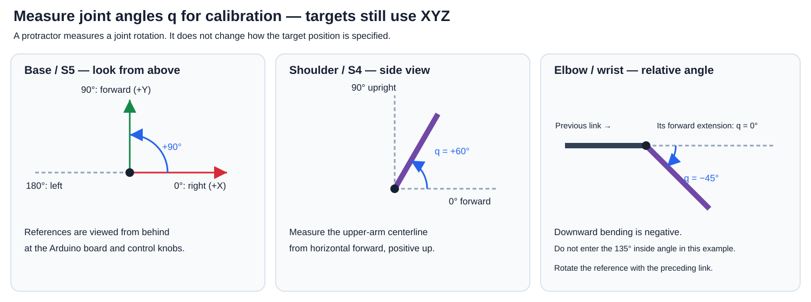

# Why calibration is needed for XYZ inverse kinematics

Read this before collecting measurements. The purpose is to connect the
mathematical robot to the actual servos, not to learn a different target
coordinate system. The target is always **X right, Y forward, Z up**, in mm in
the Python controller. The calibrator does not ask for target positions.

## 1. Three different quantities

| Quantity | Example | Meaning / where it is used |
|---|---|---|
| Target XYZ, mm | [-40,100,150] | Where the TCP should go; enter in IK CONTROL |
| Joint configuration q, degrees | [90,60,-60,-60] | Base, shoulder, elbow and wrist rotations; calculated by IK |
| Raw servo commands | One integer per S1–S5 channel | Numbers sent to the controller; determined by calibration |

The complete calculation is:

**Desired XYZ → 3D IK → joint angles q → measured calibration → raw servo commands.**

A raw command of 90 is not a measurement of 90 degrees at a joint. Servo horn
mounting, zero offsets, direction and mechanical scale can differ. Correct IK
angles can therefore produce incorrect motion if sent directly as raw numbers.
At a 200 mm reach, even a 5-degree angular error can produce roughly 17 mm of
position error. Calibration helps correct systematic command/angle differences;
it does not eliminate sag, backlash, measurement error or incorrect link lengths.

Without hardware, `--simulate` supplies a clearly labeled synthetic mapping,
ignoring any saved calibration.json without changing it. This keeps offline
exercises reproducible. Use `--simulate --use-calibration` explicitly to test
that saved hardware mapping and its limits. A synthetic mapping is not an
actual measurement and must not be used as an arm's hardware calibration.

## 2. XYZ targets and angle measurements are compatible

The robot still has rotating joints when its target is given in XYZ. To know
which command produces a desired rotation, we must measure those joint angles.
A protractor or signed-angle tool is an angular measuring instrument, not a
requirement to enter target positions as radius/azimuth/height.

**Printed polar paper is not required.** A printed protractor can be used if
convenient: above the base for its horizontal rotation and in the arm's vertical
plane for pitch joints. For target validation, use a rectangular XY grid or two
perpendicular rulers on the table and a vertical ruler for Z, measured from the
same frame {0}. Do not measure elbow/wrist pitch using a flat table's angle grid.

## 3. Use the same joint angles as the DH model

The updated calibrator accepts **measured DH joint angle q in degrees directly**.
There is no extra 90-degree-reference conversion for students to perform.

| Controller slider / channel | What to measure | Zero/reference and sign |
|---|---|---|
| Base / S5 | Heading of the rotating base, viewed from above | 0 right, 90 forward, 180 left |
| Arm = shoulder / S4 | Upper-arm centerline relative to horizontal forward, viewed from the side | 0 forward-horizontal; positive rotates up; 90 upright |
| Forearm = elbow / S3 | Forearm direction relative to the upper arm's forward extension | 0 aligned; down-forward bend negative; up-back bend positive |
| Wrist / S2 | Wrist-to-TCP direction relative to the forearm's forward extension | 0 aligned; down-forward bend negative; up-back bend positive |
| Claw / S1 | Raw commands that open and close the fingers | No DH positioning angle is required for claw opening |

For elbow/wrist, align the protractor baseline with the direction in which the
preceding link would continue past the joint. Do not use the ray pointing back
to the preceding joint. If the next link turns downward by 45 degrees, enter
**q=-45 degrees**, not the 135-degree interior angle. The preceding link may be
tilted: rotate the protractor baseline with that link, rather than measuring all
joints against the table. Wrist angle follows the tool centerline, not how far
the fingers are open.

An alternative is to measure signed absolute link pitches from the same
forward-horizontal reference in the arm's plane. If those are beta1 for upper
arm, beta2 for forearm and beta3 for the tool, then shoulder q=beta1, elbow
q=beta2-beta1 and wrist q=beta3-beta2. Choose consistent signed angles/branches;
some phone angle tools report only an unsigned acute tilt, which is insufficient
without resolving direction. A hinge-centered protractor is the simpler default.

For base measurements, use a mark on the rotating platform or a clear
forward-facing upper-arm plane. A folded-back TCP does not reliably indicate
the base heading. Keep the other joints in a clear, supported pose.

## 4. Demonstrate one joint before collecting the full table

First have the instructor demonstrate one applied command and one measured
angle. Then record two pairs to see how a command/angle mapping is formed.
Only after that collect the lab's five well-spaced pairs per joint. There are
four positioning joints, so this is 20 pairs, not 20 XYZ targets.

For example, an **illustrative wrist** might give:

| Applied raw command | Independently measured wrist q, degrees |
|---:|---:|
| 60 | +30 |
| 80 | +15 |
| 100 | 0 |
| 120 | -15 |
| 140 | -30 |

This example shows an offset, reversed direction and a scale of 0.75 degree
per raw unit. For desired q=-22.5 degrees, the software interpolates halfway
between the -15 and -30 degree measurements and sends **raw command 130**.

**These numbers are invented for explanation; do not copy them to your arm.**
Your measurements determine its mapping. Five points let the piecewise-linear
curve represent changes in slope and help identify a mistyped or mismeasured
point. Two points are the software minimum, not the lab's final measurement
requirement. More points do not fix a wrong angle reference or wrong sign.

## 5. Prepare hardware and establish the first pose

1. Upload the provided sketch with the correct board/port, Servo and the
   previously specified FastLED 3.10.3. Close Serial Monitor.
2. Enter measured axis-to-axis dimensions in GEOMETRY in the controller.
3. Run `python miniarm_controlC.py --port COM11`, replacing COM11 as appropriate.
   Run `python miniarm_calibrate.py` in a separate terminal in the same folder.
   The calibrator itself does not open a serial port or move anything.
4. Review the displayed S1–S5 startup commands with the instructor before
   clicking **Enable raw neutral (uncalibrated)** on an uncalibrated unit, or
   **Straighten arm upright** once calibrated. Connection leaves the servos disabled. INIT enables
   them at those commands immediately; it is not a motion plan from a measured
   physical starting pose. Support the unloaded arm in a clear area and follow
   the instructor's startup procedure. Do not force a powered servo.

Before the first calibration, the startup raw commands are all 90. **Their
physical joint angles are not yet known**. Do not assume this means all links
are at 90 degrees, or pretend that the uncalibrated XYZ readout measures them.
The first enable should be an instructor-guided demonstration using the unit's
known startup/neutral arrangement. Once calibrated, the displayed mathematical
upright pose q=[90,90,0,0] degrees and its raw commands are related through
that measured mapping. The button never reads the manual sliders or uses the
bent IK seed as its startup target. Upright means base forward, shoulder upright,
elbow and wrist aligned; the first enable uses the calibrated claw-open command.
If calibrated limits cannot represent upright, initialization reports an error
rather than clipping to a different pose. Once initialized, clicking the button
uses a checked gradual move from the current commanded pose, preserving the claw.
A blocked path is rejected; no automatic detour is planned.

## 6. Collect one real measurement pair

1. Select APP CONTROL and leave the other joint sliders unchanged.
2. Adjust this joint's raw command by a small amount and click **Send manual
   sliders**. Moving a slider alone does not send the command.
3. Wait for the command sequence to finish and the arm to settle.
4. Record the applied raw command for the joint, then independently measure its
   physical q using the references above. Do not use the controller's estimated
   angle as the measurement you are trying to calibrate.
5. Enter raw command and measured q in one row of the matching S-channel panel.
6. Repeat at five positions spread over its usable range. Observe the sign of
   angle change. Approach measurements consistently to reduce backlash effects.

Repeat for base, shoulder, elbow and wrist. Keep tools and other links clear.
The plot's horizontal axis is **raw command** and vertical axis is **joint q in
degrees**. It is an ordinary calibration curve, not a polar map of the workspace.
Elbow/wrist plots include negative angles.

## 7. Safe raw ranges and claw commands

Enter **safe min/max raw commands**, not joint angles. Use measured or
instructor-established limits inside mechanical stops and ensure the measurements
cover that range. The controller's possible raw range 0..180 does not mean the
mechanism can safely traverse all of it. The new form intentionally leaves
unknown limits blank. Do not discover limits by repeatedly straining the servo.

For S1, record raw commands for a useful opening and gentle closure for the task,
plus its safe raw range. Use the controller's S1 raw values, not an internal
inverted firmware value. Finger opening is independent of the positioning wrist
angle. APP and KNOB controls bypass IK collision checking, so use instructor
guidance while calibrating; provisional collision shapes are not full hardware
geometry.

## 8. Check, save, reload and validate

1. Click Check and resolve errors. Re-measure sharp bends or inconsistent
   directions; do not silently edit data to make a curve look smooth.
2. Save calibration.json, then click Reload calibration in the controller.
   Reload updates the mapping/limits and disables movement until explicitly
   initialized again; it does not move the arm.
3. Establish the displayed upright configuration q=[90,90,0,0] degrees using
   the calibrated mapping and instructor's procedure, then click
   **Straighten arm upright**. This first enable attaches immediately, not a
   gradual move from an unknown physical pose.
4. Test an additional clear pose not used as a fitted point. Compare the measured
   joint angle with the estimate and then validate FK at the three XYZ poses in
   Section 7 of STUDENT_GUIDE.md. Record the same XYZ axes/origin and units.

Interpolation passes through the fitted data by construction, so checking only
those same entries does not establish physical accuracy. Validate independently.
If the sign or reference is wrong, correct it before collecting more points.

## If Straighten arm upright bends the physical arm backward

The requested mathematical pose remains q=[90,90,0,0]. Raw commands are obtained
from your measured file, not from the slider values. Read the new terminal line
**Upright calibration conversion** to see each channel's exact raw command.
If that bends the physical arm, verify which applied raw command actually makes
shoulder q=90, elbow q=0 and wrist q=0. Compare those physical measurements with
the corresponding saved rows and the angle_convention field. A backward bend
alone does not determine whether an offset, direction or angle reference is wrong.
Do not guess a universal 90-degree correction or just change the JSON metadata.

No synthetic calibration.json is shipped. The synthetic table exists in memory
for the emulator and is never a physical calibration. Its upright raw commands
are [40,90,90,90,90], but real upright commands can differ for every joint.
The nominal elbow/wrist range is +/-90 degrees; calibrated limits may narrow it.
If the problem persists, provide the current calibration.json and whether the
controller banner says SIMULATION or Hardware port so the actual mapping can be
checked. Keep a backup of measurements before editing them.

## 9. Existing calibration files

New files explicitly contain `"angle_convention": "joint"` and store the DH
angles described here. The updated module also reads older files without that
field, applying their original measured-angle convention. Loading an older file
in the new form converts it to DH q **for display**; Save writes the new metadata
and converted table. The raw-command-to-joint-angle mapping and raw limits are
preserved, so existing measurements do not need to be repeated solely because
the display convention changed.

Update **miniarm_calibrate.py, miniarm_calibration.py and miniarm_ik.py together**
(download the latest complete repository). Do not save a new direct-q file and
then read it with an old calibration module that does not recognize the new
metadata. Keep your measured calibration.json with your own arm's files; no
real calibration is distributed as an example.
