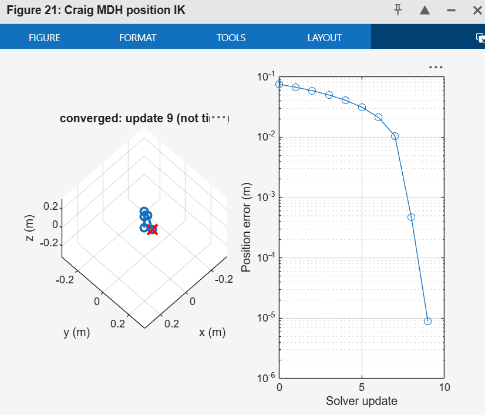

> **Complete student workflow:** [3D IK lab instructions](STUDENT_GUIDE.md) cover

**v2.0.0:** [Smooth final-target motion, firmware update and simulation/version display](SMOOTH_MOTION.md). Update Python and the Arduino sketch together; keep your measured calibration.

See the [MATLAB/Python/servo pipeline audit](PYTHON_MATLAB_AUDIT.md) for the shared frames, DH table, calibration equations and verification results.
> MATLAB verification, Python XYZ preview, calibration, Arduino execution and
> the required [report template](Lab03_Report_Template.docx).
> Start the GUI with `python miniarm_controlC.py --simulate` from
> `miniarm_controlC`; keep the sibling `python` folder. The guide below remains
> the detailed simulation reference. Historical planar-code reviews describe
> the older GUI, not the current XYZ interface.
# Lab 03 — Craig DH, Jacobian and Numerical Position IK

**Robot frames:** [Annotated miniArm illustration](matlab/README.md#frame-placement-behind-the-table),
including frame {1} directly on the arm and the shared shoulder origin.

**New to the code? Read the [MATLAB file-by-file guide](matlab/README.md)** for
the role of all nine `.m` files, DH frames, transformation matrices, FK,
Jacobian methods, numerical IK, collision checks and runnable inspection commands.
The guide also traces [what happens when demo_ik runs](matlab/README.md#execution-flow-when-you-type-demo_ik),
including the candidate joint update, conditional acceptance and next iteration.
For the mathematics behind the Jacobian loop, see the
[worked partial-derivative explanation](matlab/JACOBIAN_WALKTHROUGH.md).

**What should students see?** See the
[instructor screenshots and expected results](matlab/EXPECTED_OUTPUT.md).



*Example successful run. Your valid posture, iteration count and camera angle
may differ; use the residual, limits and clearance checks to assess the result.*

**Start with MATLAB.** In the required lab, students develop the DH table from the assigned frames
and run the provided FK, Jacobian and numerical IK code to understand the
calculation flow. The detailed reference below supports optional deeper study. The core
MATLAB code needs **base MATLAB only**. MathWorks Robotics System Toolbox is an
optional independent cross-check. A runnable NumPy reference is also included.

**Model status:** the default simulation now follows the instructor's supplied
`miniarm_ik.py` and geometry: H=120, L1=56.5, L2=61.5, L3=85 mm, with a **+90°**
shoulder twist. The original analytic Jacobian and numerical IK were executed
and checked; see [the code review](CODE_REVIEW.md). Physical calibration and
joint limits still require verification on your own arm. The earlier generic
model remains only as a regression fixture in `miniarm_example_model.m`.

## 1. MATLAB or Webots?

| Need | MATLAB | Webots |
|---|---|---|
| Inspect DH transforms and teach partial derivatives | Direct matrix calculations; easiest starting point | Possible, with additional world/controller setup |
| Implement and debug your own numerical IK | Small functions, plots and residual histories | Same math, plus simulator integration |
| View motion before hardware | Provided stick-model animation | Articulated 3D scene |
| Contact, grasping, collisions and camera images | Additional models/tools needed | Strong reason to use Webots later |
| Accurate miniArm model | Your measured DH, limits and tool transform | Your geometry, axes, limits, collision shapes and, for dynamics, inertias |

Recommendation for this course: **MATLAB kinematics first → measured model and
calibration → slow hardware trials → Webots for vision/contact tasks if needed.**
A kinematic animation establishes no collision or motor-torque guarantee.
The default miniArm model now includes configurable capsule collision checks;
see [collision handling](COLLISIONS.md). These are approximations, not measured
CAD geometry or a hardware safety guarantee.
“MATLAB Robotics System Toolbox” (MathWorks) and Peter Corke's “Robotics Toolbox
for MATLAB” are separate products. These scripts use neither Corke's API nor its
standard-DH defaults. The optional check uses MathWorks `rigidBodyTree`.

## 2. Files and quick start

| File | Purpose |
|---|---|
| `matlab/miniarm_model.m` | Edit your MDH table, tool transform, joint limits and seed here |
| `matlab/miniarm_example_model.m` | Fixed example fixture used by regression tests |
| `matlab/MiniArmIK.m` | FK, exact partial derivatives, finite differences, damped IK |
| `matlab/demo_ik.m` | XYZ input, numerical solve, animation and error plot |
| `matlab/verify_ik.m` | Closed-form, Jacobian, IK and failure checks |
| `matlab/verify_miniarm.m` | Instructor geometry, angle signs and planar Jacobian checks |
| `matlab/MiniArmCollision.m` | Capsule clearance, table checks and joint-interpolation checking |
| `matlab/verify_collision.m` | Base/tool collision and intervening-path regressions |
| `matlab/verify_toolbox.m` | Optional MathWorks FK/Jacobian comparison |
| `python/kinematics.py` | Equivalent runnable NumPy implementation and plotting CLI |
| `python/test_kinematics.py` | Independent closed-form checks and regression tests |
| `python/miniarm_source_model.py` | Instructor geometry, GUI angle/unit adapters and animated simulation |
| `python/audit_original.py` | Run FK/Jacobian/IK checks on your original local `miniarm_ik.py` |
| `python/servo_export.py` | Calibrated conversion to servo degrees; exports only |
| `VALIDATION.md` | What was actually run and what remains to be checked |

Clone/download the repository. In MATLAB set the current folder to
`lab03_inverse_kinematics/matlab`, then run:

```matlab
verify_ik
verify_miniarm
verify_collision
demo_ik
demo_ik([0.20; 0.04; 0.10])  % arbitrary XYZ target, metres
```

The default target is generated by FK of a known legal pose. This separates a
solver problem from an accidentally unreachable user-specified target. The demo
prints radians, degrees, final position error and termination status. Plot
segments connect frame origins; they are not CAD link outlines. Animation steps
are optimization iterations, **not a physical timed trajectory**.

Optional Python route, from `lab03_inverse_kinematics`:

```powershell
py -m venv .venv
.\.venv\Scripts\Activate.ps1
python -m pip install -r python/requirements.txt
python -m unittest discover -s python -v
python python/miniarm_source_model.py --plot
python python/miniarm_source_model.py --target-mm 100 40 150 --plot
python python/audit_original.py path/to/your/miniarm_ik.py
```

MATLAB and Python have separate model constructors. Edit `source_model()` in
`python/miniarm_source_model.py` to change the instructor-source model. Keep
`example_model()` as a fixed regression fixture and create a separate measured
`Model(...)` instance for your application. If using both, enter the same
measured table, tool transform and limits in both. They do not automatically
share calibration files.

## 3. Enter YOUR Craig modified-DH model

For row i the code uses:

```math
{}^{i-1}T_i = R_x(\alpha_{i-1})T_x(a_{i-1})R_z(q_i+\theta_{0i})T_z(d_i).
```

Each row is `[a_(i-1), alpha_(i-1), d_i, thetaOffset_i]` in **metres and radians**.
This is Craig **modified DH**, not standard DH. Do not reorder your table into
`[theta,d,a,alpha]`. The expanded transform is:

```math
A_i=\begin{bmatrix}
c_i&-s_i&0&a_{i-1}\\
s_i c_\alpha&c_i c_\alpha&-s_\alpha&-d_i s_\alpha\\
s_i s_\alpha&c_i s_\alpha&c_\alpha&d_i c_\alpha\\
0&0&0&1
\end{bmatrix},\quad \theta_i=q_i+\theta_{0i}.
```

Edit `miniarm_model.m`:

1. Use one row per independently actuated revolute joint in your positioning
   chain. Change the row count, `limits` and `q0` together. Gripper opening is
   handled separately. Do not count a coupled gripper actuator as an independent
   positioning DOF. The implementation supports an arbitrary number of revolute
   joints; it does not implement prismatic or mechanically coupled joints.
2. Enter your measured lengths, twists, displacements and fixed theta offsets.
   Joint variables q are mathematical radians, not servo degrees.
3. Set `base` to world-to-model-base placement as a homogeneous transform
   mapping model-base coordinates into the world. Use identity if target XYZ is
   already expressed in your frame {0}.
4. Set `tool` to the transform mapping TCP coordinates into the last DH frame.
   Define the TCP explicitly, e.g. the midpoint between gripper fingertips at a
   specified opening. An omitted tool offset can make an otherwise correct
   Jacobian and IK solve for the wrong point.
5. Enter experimentally verified mathematical joint limits and a bent seed pose
   inside them. The default simulation ranges are not calibrated hardware limits.
6. After verifying geometry and replacing limits, change `exampleOnly` to false. This is
   a label only; it does not enable hardware motion. It remains true initially
   because the physical limits/calibration are not supplied.

The current MATLAB/Python simulation vector is
`[base_angle; shoulder; elbow; wrist]` in radians. Frame {0} is **x right,
y forward, z up**, viewed from behind at the Arduino/knobs. Base angle 0 means
right, 90 forward and 180 left; no -90 degree offset is applied. The original
uploaded GUI used x forward/y left, so its old XYZ converts as
`x_new=-y_old`, `y_new=x_old`, `z_new=z_old`. Its planar Distance/Height still
have the same physical meaning. MATLAB XYZ inputs are metres; the original
GUI uses millimetres/degrees. Convert units and frames explicitly.

FK is `T = base*A1*...*An*tool`; position is `T(1:3,4)` in the same frame as the
target. All revolute joints are rotations about their Craig z_i axes. Avoid
copying the standard-DH “previous-frame z-axis” shortcut into a modified-DH
model without deriving the appropriate axis location.

Before IK, measure at least five actual poses spanning the workspace. Record q,
measured TCP XYZ, predicted XYZ and position error. Include one-joint changes to
check axis direction and zero offsets. A solver cannot repair an incorrect DH
table, tool definition or servo-to-joint mapping.

## 4. What the Jacobian means

For position-only IK, `p(q)=[x;y;z]` and `J=dp/dq` is **3 by n**, in metres per
radian. Column j answers: “If I rotate only joint j slightly, how does the TCP
position change?” Locally, `delta_p ≈ J*delta_q`.

### Exact partial-derivative method

`MiniArmIK.jacobian(m,q,'partial')` differentiates the transform product:

```math
\frac{\partial T}{\partial q_j}
=T_{base}A_1\cdots A_{j-1}
\frac{\partial A_j}{\partial q_j}
A_{j+1}\cdots A_nT_{tool}.
```

The top three entries in column 4 of this derivative are J(:,j). The code
explicitly differentiates sine/cosine entries of A_j. It needs no symbolic
package and differentiates the TCP offset as part of the product.

### Perturbation / finite-difference method

`MiniArmIK.jacobian(m,q,'finite')` uses central differences:

```math
J_{:,j}\approx\frac{p(q+h e_j)-p(q-h e_j)}{2h},\qquad h=10^{-5}\text{ rad}.
```

This is a numerical partial derivative, so your proposed “disturbance” approach
is valid. Perturb exactly one mathematical joint at a time and divide by the
perturbation. Use radians throughout. Central differences have second-order
truncation error for smooth FK; excessively small h causes floating-point
cancellation. Try h = 1e-3, 1e-4, 1e-5, 1e-6 and compare.

Model perturbations may cross a joint limit slightly: this differentiates the
smooth FK formula and does not command a physical joint. Do not clamp perturbed
angles during this check, which would change the derivative at the boundary.

### Checks for your current implementation

```matlab
m=miniarm_model(); q=m.q0;
Ja=MiniArmIK.jacobian(m,q,'partial');
Jn=MiniArmIK.jacobian(m,q,'finite');
disp(Ja); disp(Jn); disp(norm(Ja-Jn,'fro'));
dq=1e-6*[1;-1;1;-1];  % adapt length if you change the number of joints
p0=MiniArmIK.fk(m,q); p1=MiniArmIK.fk(m,q+dq);
disp([p1-p0, Ja*dq]);
```

Check multiple nonsingular poses, not just home. The supplied verification also
checks an independent closed-form yaw/pitch model. Derivatives agreeing with
finite differences of the same FK establishes **internal consistency**; both
can still share a wrong physical model. Physical measurements are the next
independent check. The example-specific closed-form tests should remain as
regression tests; add measured-pose tests for your replacement model separately.

## 5. Numerical IK, step by step

At each iteration:

1. Compute actual model position `p=FK(q)` and error `e=target-p`.
2. Compute the 3-by-n position Jacobian at this q.
3. Solve the damped least-squares update:

   ```math
   \Delta q=J^T(JJ^T+\lambda^2I_3)^{-1}e.
   ```

   Code uses a linear solve, not an explicit inverse. Damping is 0.01 with
   this metre/radian model (same numerical scale as Jacobian singular values).
   Reconsider damping if you change units or arm scale.
4. Limit the total update norm to 0.10 rad, project candidate q into joint limits,
   and backtrack until the actual nonlinear position error decreases. If a
   collision model is configured, also require its clearance constraints along
   the straight joint interpolation to the trial pose. A colliding seed fails
   immediately, even if its position error is zero.
5. Stop at residual ≤1e-4 m, stalled descent, or 400 updates.

The 0.1 mm tolerance is an algorithm demonstration, not a promised hardware
accuracy. Damping regularizes singular configurations; it does not guarantee
convergence. Limit projection and backtracking are deliberately simple teaching
choices, not a full constrained optimization solver.

`success=false` means **no solution was found from this seed**; it does not prove
the target is globally unreachable. Try several legal bent seeds after checking
frames and geometry. At a straight-arm singularity, some requested displacement
directions can have zero first-order motion, so even a reachable target may
stall. Never label an unsuccessful final q as a valid IK solution.

With four positioning joints and only XYZ specified, multiple joint solutions
are generally possible. This solver starts near the seed but does not optimize
posture or guarantee the nearest solution. For sequential targets seed each
solve with the preceding successful q, then check continuity and limits.
It does **not** constrain gripper pitch or full orientation. A future pick/place
task may require a pitch constraint, a fixed wrist assumption, or a new task
Jacobian. An arm with too few independent DOFs cannot generally realize an
arbitrary 6D pose.

## 6. Optional MathWorks cross-check

With **Robotics System Toolbox**, run `verify_toolbox` (also called automatically
by `verify_ik` when available). It constructs the same MDH chain and compares
full FK and the **linear rows 4:6** of `geometricJacobian` against our position
Jacobian. MathWorks returns angular rows first.

Important offset detail: `setFixedTransform(joint,[a alpha d theta],'mdh')`
ignores theta for a revolute joint. The adapter therefore passes zero in that
column and supplies **theta=q+thetaOffset** as the toolbox configuration. Limits
are shifted consistently. A nonzero offset must not silently disappear.

The custom solver stays visible to students; the toolbox is a reference check,
not a replacement black-box IK call. Core tests and the animation run without
Robotics System Toolbox or Symbolic Math Toolbox.

## 7. From simulation angles to servos

Keep these three mappings separate:

```text
desired XYZ -> numerical IK q (radians)
q -> calibrated servo angles (degrees)
servo angles -> verified firmware/controller commands
```

Do not simply send `rad2deg(q)` to the servos. A common calibration model is:

```math
s_i=b_i+k_i\,\mathrm{rad2deg}(q_i).
```

Here b_i is the servo command at mathematical q_i=0; k_i is a measured signed
ratio (often +1 or -1 for direct drive). Do not assume those values. Fixed theta
offsets in the DH model and servo offsets describe different mappings; document
both against the same physical zero pose.

Use a calibration worksheet with columns: mathematical joint, physical servo
ID, q at reference, servo command at reference, signed gain, q minimum/maximum,
servo minimum/maximum, and measured TCP. Confirm servo order one joint at a time.
The earlier setup guide lists S1 claw through S5 base/pan; verify that mapping
on your unit rather than equating row i with servo i.

`python/servo_export.py` provides a tested conversion/export function. It refuses
an example model, failed IK, unverified calibration, invalid values, out-of-range
joint/servo angles and duplicate servo IDs. It writes CSV only; **it sends no
serial commands**. Call it from your application after replacing the model and
creating measured `Calibration` entries. Its output is for inspection first.

Hardware procedure:

1. Verify DH FK against measured poses and identify all servo IDs/signs/zeros.
2. Test angle conversion on paper at reference poses and joint limits.
3. Identify your installed firmware's documented command interface. This repo's
   old `MOVE,...` line was a **proposed custom protocol**, not a Hiwonder feature;
   default firmware is not assumed to accept it. Implement/test a receiver and
   acknowledgement mechanism only after confirming controller/pins/protocol.
4. Start at a known measured pose; ordinary hobby-servo commands do not establish
   that the actual arm has reached the requested joint angles. Resetting a PC
   seed to q0 does not home the robot.
5. Solve a nearby target, inspect the final pose and the intervening joint path,
   and reject failed solves. Use small, slow, interpolated joint commands with
   experimentally selected speed limits. Solver iterations are not a safe
   execution trajectory. Check intermediate positions for table/self collisions.
6. Keep gripper control separate. Test one joint first, then several nearby XYZ
   targets; compare measured versus requested TCP positions.

**Current boundary:** simulation code and conversion are provided; an unverified
Arduino receiver or guessed servo pin map is not included. Firmware integration
and physical calibration remain specific to your unit. Continue following
[Lab 00](../lab00_setup/README.md) for power/upload precautions.

## 8. Webots extension after the kinematics check

Build/import a model whose joint axes, origins and tool point match your
measured chain. Name the revolute motors and position sensors explicitly. Keep
the base fixed. Use joint limits in radians and enable position sensors. Enter
collision shapes and realistic masses/inertias when evaluating contact/dynamics.

Before enabling IK, command one joint at a time and compare the simulated TCP
world position to `base*A1*...*An*tool`, transforming into the same world axes.
Do this at several poses. Then reuse the same IK function with measured/simulated
joint positions as the seed, check success, interpolate joint targets, command
the motors and wait for measured settling. An XYZ success computed only from
the solver's own FK is not an independent Webots validation.

No ready-to-run Webots miniArm world is claimed here: without the instructor's
geometry it would merely duplicate the illustrative model. MATLAB already
provides the requested first simulation with much less setup.

## 9. Student deliverables

- Frame drawing, measured Craig table, units, TCP and calibration worksheet.
- FK versus measurements at five or more poses.
- Exact and finite-difference Jacobians at three poses; discrepancy and local
  displacement prediction. Explain what one column means physically.
- Animation and error histories for three reachable targets and one failure;
  include seed, final q, residual and termination status.
- Explanation of redundancy, singularity, position versus orientation, and why
  model consistency does not prove physical accuracy.
- Only after hardware calibration: commanded versus measured XYZ and a short
  slow-motion demonstration.

## Official references

- [MathWorks: setFixedTransform (DH/MDH conventions and ignored joint variable)](https://www.mathworks.com/help/robotics/ref/rigidbodyjoint.setfixedtransform.html)
- [MathWorks: geometricJacobian (angular/linear row order)](https://www.mathworks.com/help/robotics/ref/rigidbodytree.geometricjacobian.html)
- [MathWorks: rigidBodyTree](https://www.mathworks.com/help/robotics/ref/rigidbodytree.html)
- [Cyberbotics: Introduction to Webots](https://cyberbotics.com/doc/guide/introduction-to-webots)
- [Cyberbotics: Physics nodes](https://cyberbotics.com/doc/reference/physics)


