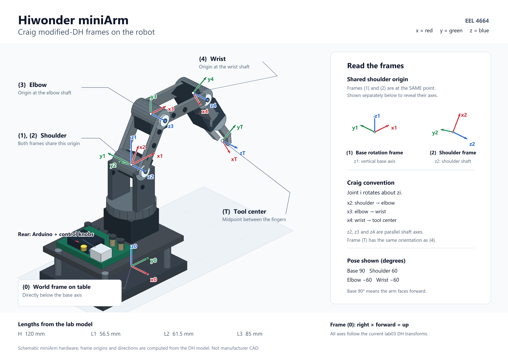
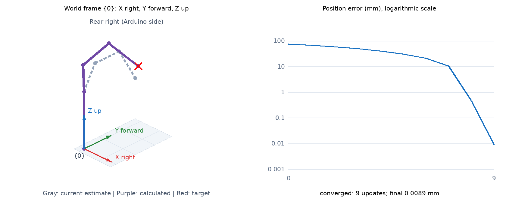
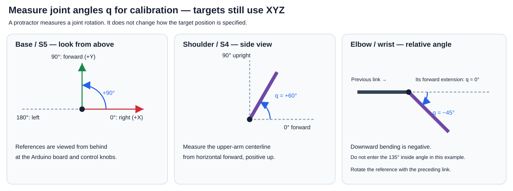

# Lab 03 — From DH parameters to inverse kinematics and robot motion

**Develop the DH table from the assigned frames, understand how the provided
code turns that table into robot motion, and run it in MATLAB and the Python GUI.**
You are not required to write the FK, Jacobian or numerical IK algorithms.

## What you will do

1. Use the instructor's assigned frames to develop and explain the Craig
   modified-DH table, including the fixed tool offset.
2. Follow the calculation flow: **DH table → transformations → FK → Jacobian
   → numerical IK → calculated joint angles**.
3. Run the provided MATLAB simulation and interpret its results.
4. Run the provided Python GUI, then use your calibrated arm to test XYZ targets.
5. Submit screenshots, experimental results and a short explanation in the
   [report template](Lab03_Report_Template.docx).

Use the assigned frames throughout; you do not need to invent a new frame
assignment. Work in teams of three with one arm. Review Lab 02 and the course
material on DH parameters and numerical IK.

Detailed derivative calculations, finite-difference comparisons, unit tests and
tracing numerical values through an IK iteration are **optional enrichment**.
They are collected in [Optional Jacobian verification](OPTIONAL_JACOBIAN_VERIFICATION.md)
and are not required in the report.

## 1. Get the provided files

Download and extract the complete repository. Keep `matlab`, `python` and
`miniarm_controlC` together inside `lab03_inverse_kinematics`. The GUI imports
the shared solver from `../python`; copying only the GUI folder will not work.

| File | What to look for |
|---|---|
| `matlab/miniarm_model.m` | DH table, tool offset, dimensions and starting joint angles |
| `matlab/MiniArmIK.m` | `mdh`: transformations; `fk`: FK; `jacobian`: Jacobian; `solve`: numerical IK |
| `matlab/demo_ik.m` | Loads the model, runs IK, displays the arm and position-error curve |
| `python/kinematics.py` | Python version of the same FK, Jacobian and numerical IK calculations |
| `miniarm_controlC/miniarm_ik.py` | Connects the shared solver to calibration and servo commands |
| `miniarm_controlC/miniarm_controlC.py` | GUI for XYZ entry, preview and movement |
| `miniarm_controlC/miniarm_calibrate.py` | Provided form for entering measured calibration |
| `miniarm_controlC/miniarm_calibration.py` | Converts between measured angles and servo values |
| `miniarm_controlC/miniarm_controlC/miniarm_controlC.ino` | Provided Arduino sketch for servo control |

You may need to enter your arm dimensions and serial port or load calibration.
You do not need to modify the supplied mathematical algorithms.

## 2. Develop the DH table using the assigned frames



*Assigned frames on the miniArm. Red = X, green = Y, blue = Z. Frames {1}
and {2} share the shoulder origin; both are drawn on the arm, and the inset
shows their axes separately for clarity. The illustrated pose is
[base, shoulder, elbow, wrist] = [90°, 60°, −60°, −60°]. The hardware drawing
is schematic; frame origins and directions follow the lab's DH model.*

[Open or download the full-resolution frame illustration](matlab/images/miniarm_craig_dh_frames.png)

Viewed from behind the arm at the Arduino and knobs, frame {0} has
**X right, Y forward and Z up**. The base angle is 0° right, 90° forward and
180° left. The four positioning joints are base, shoulder, elbow and wrist;
claw opening is controlled separately.

Use the instructor's frame drawing and the frame descriptions in the
[MATLAB guide](matlab/README.md). Reproduce the assigned frames {0}–{4} and {T}
on your sketch or photograph. Show each origin and X, Y, Z direction.

1. Identify the joint axes and measure the link dimensions.
2. Determine the four parameters for each Craig modified-DH row:
   `a_(i-1), alpha_(i-1), d_i, theta_i`.
3. State which parameter changes as each joint moves.
4. Record the fixed wrist-to-tool transform separately.
5. Fill in `miniarm_controlC/DH_table.txt` and compare your result with
   `matlab/miniarm_model.m`. Explain any differences before running.

The default dimensions are H=120, L1=56.5, L2=61.5 and L3=85 mm.
In the model file, the last DH column contains a **fixed angular offset**;
the code adds the current joint angle to it.

## 3. Understand the calculation flow

| Stage | Input | What the provided code does | Output |
|---|---|---|---|
| DH model | Assigned frames and measured geometry | Stores the link parameters | DH table and tool transform |
| Transformations | DH parameters and current joint angles | Constructs a transformation matrix for each joint | Individual link transformations |
| FK | Current joint angles and link transformations | Multiplies the transformations from base to tool | Current end-effector XYZ |
| Jacobian | Current joint angles | Calculates how XYZ responds to small changes in each joint | A 3×4 matrix |
| Numerical IK | Desired XYZ and an initial joint configuration | Repeatedly updates the joint angles to reduce position error | Joint angles and final error |
| Servo control | Calculated angles and calibration | Converts angles into commands and checks the proposed motion | Commands sent to Arduino |

**How to read the Jacobian:** its three rows correspond to X, Y and Z, and
its four columns correspond to base, shoulder, elbow and wrist. For example,
the first column describes how X, Y and Z change when only the base angle
changes. You should understand this meaning; you do not have to derive or
calculate every entry.

**How the IK loop works:**

1. Start with an initial set of joint angles.
2. Run FK to find the current end-effector position.
3. Subtract the current XYZ from the desired XYZ to get position error.
4. Calculate the Jacobian at the current joint angles.
5. Use the damped least-squares method to calculate a small joint-angle update.
6. Add that update to the current angles and check the trial configuration.
   Accept it when the actual position error decreases and the checks pass;
   otherwise try a smaller update.
7. Repeat with the accepted new angles until the error is small or the solver
   reports that it cannot continue.

The key update is **new joint angles = current joint angles + accepted update**.
FK and the Jacobian are recalculated as the joint angles change.

In MATLAB, `demo_ik` loads `miniarm_model`, calls `MiniArmIK.solve`, then
animates the recorded configurations and plots the error. The animation
shows solver updates, not a timed physical trajectory.

For additional explanation, see the [MATLAB execution flow](matlab/README.md#execution-flow-when-you-type-demo_ik).
For optional calculations and tests, see
[Optional Jacobian verification](OPTIONAL_JACOBIAN_VERIFICATION.md).

## 4. Run the MATLAB simulation

In MATLAB Online or desktop MATLAB, open the provided `matlab` folder and run:

```matlab
verify_miniarm
verify_collision
demo_ik
demo_ik([-0.040; 0.100; 0.150])
```

Run these scripts as provided. You do not need to recreate their tests.
The final command requests X=-40, Y=100, Z=150 mm; MATLAB inputs are in
**metres**. Base MATLAB is sufficient; the toolbox comparison is optional.

Inspect the target, final arm configuration, calculated joint angles and
position-error curve. Save a screenshot and record whether the solver
converged and its final error. Try at least three targets, including different
X, Y or Z values. Compare with the [expected screenshots](matlab/EXPECTED_OUTPUT.md).

The claw orientation is free. Different valid joint configurations may reach
the same XYZ, and reaching XYZ does not guarantee a useful grasping orientation.

## 5. Run the Python GUI offline

From a terminal in `miniarm_controlC`, run:

```console
python -m pip install -r requirements.txt
python miniarm_controlC.py --simulate
```

Use the same Python interpreter for installation and execution. The standard
Windows Python installer includes Tkinter; on Linux install your distribution's
Tk package if needed.

No Arduino connection is opened in this mode. Without `calibration.json`, the
GUI uses a labeled **synthetic calibration** for offline testing only.

1. Click **Initialize at startup pose** to initialize the emulator.
2. Select **IK CONTROL**.
3. Enter X, Y and Z in **millimetres**, for example `-40`, `100`, `150`.
4. Click **Calculate / Preview**. Inspect the arm, target, calculated angles,
   position error and error curve. This does not send a movement.
5. Click **Move Arm** to execute the checked sequence in the emulator.
6. Save a screenshot and experiment log.

The preview defaults to **Rear right (Arduino side)**: an orthographic view
from behind and above the arm, consistent with the annotated frame illustration.
Use **Preview camera** to select Rear, Top or Right side without moving the arm
or changing XYZ. The colored arrows mark **world frame {0}**, not the moving
DH frames at every joint; their display lengths are arbitrary. A colored
circle in Top/Side views means an axis points toward you.

After Calculate / Preview, **gray dashed links show the current estimate** and
**purple links show the calculated candidate**; the red x is the target. The
readout above the drawing remains the current commanded-pose estimate until
Move Arm executes. A preview by itself does not move the emulator or hardware.



*Reference rendering of the actual Canvas drawing commands for X=40, Y=100,
Z=150 mm. Native window controls and fonts may differ. This is a positive-X
example; the earlier sample entry of -40 mm is a different target.*

Use the same target in MATLAB and Python and compare the results. First
compare the shared XYZ axes and units. The GUI's calibrated joint limits and
servo rounding can produce different final angles or errors.

| Trial | X mm | Y mm | Z mm | Purpose |
|---|---:|---:|---:|---|
| A | -40 | 100 | 150 | Left of center |
| B | 40 | 120 | 160 | Right of center |
| C | 0 | 130 | 130 | Center, different height |
| D | 1000 | 1000 | 1000 | Unreachable; movement should be unavailable |

A–C are candidate trials; calibrated limits and starting posture can cause
rejection. Record failures and use an instructor-approved nearby replacement
for hardware if needed. A local solver failure does not prove that no solution exists.

## 6. Understand calibration, then calibrate

### Why do we need it?

IK calculates mathematical joint angles; servos accept raw command numbers.
Because mounting zeros, direction and scale can differ, sending a number such
as 90 does not guarantee a physical joint angle of 90 degrees. Calibration
measures that relationship for your arm:

**Desired XYZ → 3D IK → joint angles q → calibration → raw servo commands.**

The target remains **X, Y, Z in millimetres**. Joint-angle calibration is still
needed for XYZ IK. It does not require polar target coordinates or polar paper.
A protractor is simply one way to measure an angle; use an XY grid/rulers and a
vertical ruler later to measure the actual target/TCP position.

### What exactly do we measure?

Each row in the calibrator is one **(applied raw servo command, measured DH joint
angle q)** pair. The updated form uses the same q convention as MATLAB directly:

| Joint / GUI slider | Channel | What the measured q means |
|---|---|---|
| Base | S5 | 0° right, 90° forward, 180° left; measured from above |
| Shoulder / Arm | S4 | 0° horizontal forward, 90° upright; measured from the side |
| Elbow / Forearm | S3 | 0° aligned with the upper arm's forward extension; down-forward bend is negative |
| Wrist | S2 | 0° aligned with the forearm's forward extension; down-forward bend is negative |
| Claw opening | S1 | Record raw open/closed commands, not a positioning joint angle |



At elbow/wrist, align the protractor with the previous link's **forward
extension**, not the ray pointing back to the previous joint. A 45° downward
bend means q=-45°, not the 135° interior angle. Rotate this reference with the
preceding link if it is tilted.

### Learn one mapping before collecting the full table

Have the instructor demonstrate one joint first. For an illustrative wrist,
raw commands 60, 80, 100, 120, 140 might produce q=30°,15°,0°,-15°,-30°.
Then q=-22.5° needs raw command 130 by interpolation. **These are made-up
example values, not settings to copy.** First observe two pairs to understand
the mapping, then collect the lab's five points per positioning joint.

### Hardware procedure

Read the [calibration walkthrough](CALIBRATION_GUIDE.md) before enabling servos.
It explains startup, measurement tools, safe ranges and independent validation.

1. Upload `miniarm_controlC/miniarm_controlC.ino` using the correct board/port,
   Servo and FastLED 3.10.3. Close Serial Monitor and enter measured GEOMETRY.
2. Start `python miniarm_controlC.py --port COM11` with your port, and run
   `python miniarm_calibrate.py` alongside it. Click **Why calibrate? / How to
   measure** in the calibration window. That form does not move the arm.
3. Review the displayed S1–S5 startup commands with the instructor and establish
   the first pose before clicking Initialize. Without calibration, raw commands
   are all 90 but their physical angles are unknown. INIT attaches servos
   immediately; it does not plan from a measured initial pose. Do not assume
   that an uncalibrated estimate identifies the physical starting configuration.
4. Select APP CONTROL. Change one slider, click **Send manual sliders**, wait
   for completion, and record its applied raw command and independently measured
   q. A slider change without sending is not a measurement. Keep the other
   joints unchanged. Repeat at five positions across its usable range.
5. Enter measured/instructor-established **raw** safe limits for each channel and
   raw claw open/closed settings. The entire command range 0–180 is not assumed
   mechanically safe; the new form leaves unknown limits blank.
6. Click Check, resolve errors, Save, and Reload calibration in the controller.
   Reloading does not move the arm and requires explicit initialization again.
   Validate an extra pose independently before collecting the XYZ results below.

New files declare `angle_convention=joint`. Older calibration files are still
supported and converted for display without changing their command mapping.
Update the controller/calibration scripts together using the latest repository;
see the walkthrough for details. Keep your own measured calibration.json.

APP and KNOB controls bypass IK collision checking. The provisional capsules
do not fully model the camera, fingers, held objects or surrounding equipment.
Use instructor guidance while calibrating; no collision-code development is
required for this lab.

## 7. Validate FK and execute XYZ targets

For three distinct, clear poses, record mathematical joint angles, predicted
XYZ and measured XYZ relative to the same origin. Compute the Euclidean
position error `sqrt(dx**2 + dy**2 + dz**2)`; aim for **5 mm or less**.
Check frames, dimensions, calibration and measurement before blaming one cause.

In IK CONTROL, repeat Calculate / Preview then Move Arm for A–C or approved
replacement targets. Keep the first tests at Z ≥ 60 mm. Record iterations,
numerical residual, rounded-command miss, measured XYZ and measured target error.
The measured error goal is **10 mm or less**. Submit out-of-tolerance results
honestly with an explanation and corrective attempt.

The GUI preserves claw opening during IK, starts from Arduino's last reported
commanded pose, and queues one J waypoint at a time, waiting for OK. Each J
executes base → shoulder → elbow → wrist → claw. Python checks each raw-unit
step, including calibration knots, before enabling movement. The firmware
reports issued servo commands, not measured shaft angles. It cannot detect
stall, sag, slippage or a physical collision. STOP cancels the remaining queue
and asks Arduino to hold its current commands; it is a software stop.

Changing the target, calibration or mode requires a new preview. A reset or
communication failure requires re-establishing the pose and initialization.
Do not turn knobs during IK; knob movement triggers takeover and cancels the queue.

## 8. Pick and place

Choose an object and two positions your calibrated arm can reach with useful
claw orientations. Record their XYZ. Using IK CONTROL and the claw buttons:

1. Open the claw. Preview and move to ≥40 mm above the object.
2. Preview and move to grasp height; close the claw.
3. Lift, move above the destination, and lower, previewing each new target.
4. Open the claw and retreat upward.

Free claw pitch can prevent a successful grasp even when XYZ is accurate.
Document that limitation and any changed targets or object placement. Record
a video and save the log. Do not force a failed or obstructed trajectory.

## 9. Submit the report and supporting evidence

Use [Lab03_Report_Template.docx](Lab03_Report_Template.docx). Submit:

- Your DH table developed from the assigned frames, measured dimensions and
  labeled frame sketch.
- A short explanation of **DH table → FK → Jacobian → numerical IK → servo
  commands**, in your own words.
- MATLAB screenshots and results for three targets, plus a Python GUI preview.
- Calibration evidence, three FK measurements and three physical IK trials.
- Unreachable-target rejection, pick-and-place video and experiment log.
- A brief discussion of errors, failed trials and free claw orientation.

Attach `DH_table.txt` and your measured `calibration.json`.
No original solver code, full numerical Jacobian, finite-difference comparison
or hand-calculated IK iteration is required. If you change setup values, state
which values you used. Label hardware experiments that were not performed.

## Troubleshooting

| Symptom | Action |
|---|---|
| `No module named serial` or `numpy` | Install requirements with the Python used to launch the GUI |
| Cannot find `kinematics` | Restore sibling `../python` folder; download the complete repository |
| Port access denied | Close Serial Monitor and other GUI instances; check the port |
| Window does not initialize automatically | Expected; arrange startup pose and click Initialize |
| Move Arm disabled | Select IK mode, initialize, load calibration, then Calculate / Preview |
| Starting pose collides | Inspect the physical pose/model; establish a clear starting pose manually |
| IK converges but execution path rejected | Sequential rounded servo motion differs from continuous solver motion; try a closer target or a clear starting posture |
| Solver residual tiny, measured error large | Check calibration, dimensions, reference origin, backlash and load |
| Target works offline but fails on hardware | Actual calibrated limits differ from the synthetic mapping |

Further details: [MATLAB guide](matlab/README.md),
[optional Jacobian calculations and tests](OPTIONAL_JACOBIAN_VERIFICATION.md),
[collision model](COLLISIONS.md).


