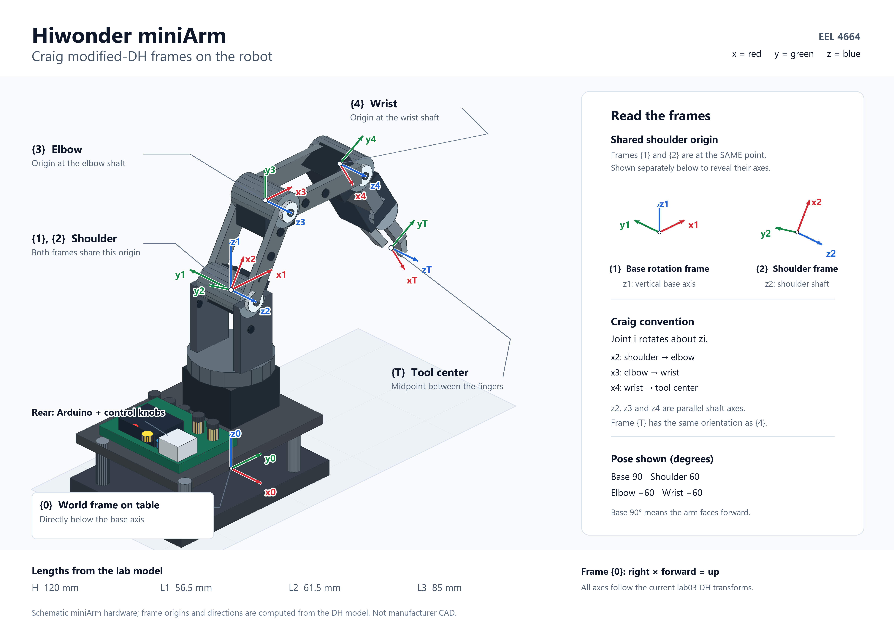

# Lab 03 — DH modeling, 3D inverse kinematics and miniArm control

**Start here.** Work in your assigned team with one miniArm. Develop the Craig modified-DH table, run the provided MATLAB simulation, calibrate your arm, and demonstrate an XYZ move plus pick-and-place of at least two randomly placed blocks into a cup. The FK, Jacobian and IK implementations are provided; you do not need to write a new solver.

## 1. Get the files and identify the frames

**Recommended: fork, then clone.** On [the instructor repository](https://github.com/hoanbklucky/eel4664-robotic-arm-project-miniArm), click **Fork** to create a copy in your GitHub account. In VS Code, press **Ctrl+Shift+P → Git: Clone**, paste your fork's URL (`https://github.com/YOUR_USERNAME/eel4664-robotic-arm-project-miniArm.git`), choose a local folder, then open it. Install Git if VS Code requests it.

Make your edits in this clone. Use VS Code **Source Control** to review/stage intended files, enter a commit message, **Commit**, then **Push/Sync Changes** to your fork. Put your fork URL in the final report. See the [beginner setup/terminal walkthrough](miniarm_controlC/README.md#beginner-setup-terminal-and-com-port).

Keep `matlab`, `python` and `miniarm_controlC` together. Preserve your measured `calibration.json` when updating. That file is intentionally Git-ignored: submit it separately. Include accessible video links in your report and repository README. Keep large recordings out of Git; link to hosted videos instead. Submit your final report PDF privately through the course submission system; do not upload the report or member contributions to GitHub.



Viewed from behind at the Arduino/knobs: **X right, Y forward, Z up**. Positioning joints are **base, shoulder, elbow, wrist**; claw opening is separate. The target is XYZ only; claw orientation is not constrained.

Use the assigned frames to derive each row `[a_(i-1), alpha_(i-1), d_i, thetaOffset_i]`. Explain each length, twist, displacement and zero offset, then specify the fixed wrist-to-tool transform separately. Measure axis-to-axis dimensions and identify the tool center point (TCP). Compare with `matlab/miniarm_model.m`; its fourth column is a fixed offset, added to the changing joint angle.

The default dimensions are H=120, L1=56.5, L2=61.5, L3=85 mm. Use the same measured geometry in MATLAB and the Python GUI's `GEOMETRY`.

**Calculation flow:** DH → link transformations → FK → position error and Jacobian → numerical IK joint updates → calibrated servo commands. See the [MATLAB file/code guide](matlab/README.md) for frame placement, each `.m` file and the loop inside `MiniArmIK.solve`.

## 2. Run MATLAB

Open `lab03_inverse_kinematics/matlab` as MATLAB's current folder, locally or in MATLAB Online. Base MATLAB is sufficient; Robotics System Toolbox is optional.

```matlab
verify_miniarm
verify_collision
demo_ik
demo_ik([-0.040; 0.100; 0.150])
```

The last target is X=-40, Y=100, Z=150 mm. **MATLAB takes metres; the Python GUI takes millimetres.** Inspect the final arm, calculated angles, convergence status and position-error curve. Try another clear target. Different valid joint configurations can reach the same XYZ.

The animation replays numerical solver updates; it is not a timed physical trajectory. Compare with the [expected MATLAB output](matlab/EXPECTED_OUTPUT.md).

## 3. Preview offline in Python

**Open the correct folder before typing Python commands:**

1. In VS Code, open the cloned repository folder, then choose **Terminal → New Terminal** (PowerShell on Windows).
2. From the repository root, type:
   
   ```powershell
   cd .\lab03_inverse_kinematics\miniarm_controlC
   dir miniarm_controlC.py
   ```
3. The second command must list `miniarm_controlC.py`. If it does not, you are in the wrong folder. The similarly named nested `miniarm_controlC` folder contains the Arduino sketch, not the Python GUI.
4. Run the commands below. Do not type the prompt such as `PS C:\...` itself. If Windows uses `py`, replace `python` with `py` consistently, including installation.

The [terminal walkthrough](miniarm_controlC/README.md#beginner-setup-terminal-and-com-port) also shows File Explorer and absolute-path methods.

```console
python -m pip install -r requirements.txt
python miniarm_controlC.py --simulate
```

The banner must say **SIMULATION — NO PHYSICAL MOVEMENT**. Simulation initializes automatically in IK CONTROL using synthetic calibration; no startup click is required. Synthetic data is not your physical calibration.

1. Enter XYZ in mm, for example `-40, 100, 150`.
2. Click **Calculate / Preview**. Check the result and error curve.
3. Click **Move Arm** after a successful checked preview.

**Solid purple = current estimated pose; dashed blue = target pose; red × = requested XYZ.** The dashed IK target stays fixed while the solid arm moves toward it. Editing XYZ requires a new Calculate / Preview before Move Arm. Camera changes do not move the robot.

APP CONTROL shows Base → Shoulder → Elbow → Wrist → Claw sliders. Slider edits change the dashed target only; Send moves the solid estimate. Returning from IK synchronizes sliders with the current servo-command estimate. Use **Send all five** for the full slider pose; a per-servo Send moves only that servo.

## 4. Connect and calibrate the real arm

**Why calibrate?** IK calculates DH joint angles, while servos accept raw commands. Your measured calibration converts between them. A raw command of 90 does not generally mean a joint angle of 90°. Targets remain XYZ; no polar workspace paper is needed.

Follow the [calibration walkthrough](CALIBRATION_GUIDE.md) for measurement references, five samples per positioning joint, safe raw limits, claw settings, and Check/Save/Reload.

1. Upload `miniarm_controlC/miniarm_controlC.ino` from the GUI folder using the correct board/port, Servo and **FastLED 3.10.3**. Close Serial Monitor.
2. Find the arm's port in **Device Manager → Ports (COM & LPT)**. Near the top of `miniarm_controlC.py`, set `SERIAL_PORT` to the **exact COM port name shown for your connected board**, including the COM prefix and number, inside quotation marks. Save the file, then run `python miniarm_controlC.py` from the Python GUI folder.
   
   For real hardware, omit `--simulate`. Confirm **GUI v2.2.1 / Firmware 2.1.0** and a REAL ROBOT banner. If needed, check the port and use **Retry connection**.
3. **After the real GUI connects, you MUST click Enable servos one by one to initialize before using the other robot controls.** Connection alone does not initialize it. Clear the workspace and support the unloaded arm without entering pinch points. Shoulder → elbow → wrist → base → claw enable with one-second pauses. Each servo may still move quickly on first enable; unenabled joints can sag. Wait until controls unlock. The claw uses its calibrated startup opening.
4. For a first calibration, use the instructor-supervised **Enable raw neutral (uncalibrated)** action instead. It uses the same sequential enable, but raw 90 has unknown physical joint angles.
5. Run `python miniarm_calibrate.py` alongside the controller. In APP CONTROL, change and **send one joint**, let it settle, and measure its physical DH angle independently. Save your measured `calibration.json`, click **Reload calibration**, and enable again. New files use `"angle_convention": "joint"`.

Once initialized, **Slowly straighten upright** makes a checked, gradual return lasting at least five seconds, longer for large changes. It preserves the claw command. No recalibration is needed merely because you updated from the previous joint-mode calibration software.

### Printable coordinate maps

- [Standard Letter version](maps/miniArm_test_mat_Letter.pdf)
- [School-printer version](maps/miniArm_test_mat_Letter_SCHOOL_PRINTER.pdf) — use this version when printing on the school printer.

Print the standard version at **100% / Actual size**, not Fit to page. The school-printer version is already enlarged to compensate for that printer; do not add further enlargement. Check the printed scale with a ruler: grid squares should be **10 mm** and the marked box **55 × 120 mm**.

Orient the arm to face the large arrow. The top/bottom numbers give **Y (forward)**; side numbers give **X**, positive to the robot's right. Align the map's coordinate origin with the GUI's base-frame origin; account for any offset if they do not coincide. Place blocks at different reachable locations, read X/Y at each block's grasp point, and enter them in the GUI in millimeters. Set **Z separately** to the claw's grasp height; the map only supplies X/Y. The grid is a coordinate aid, not a guarantee that every printed location is reachable.

## 5. Demonstrate a physical XYZ move

1. Use the printed map above to read a nearby, clear target's X/Y coordinates. Select **IK CONTROL**, enter X/Y in mm, and choose Z separately; start with Z ≥ 60 mm. Use the same frame {0} origin as your simulation.
2. Click **Calculate / Preview**. Check the dashed target, success message, error and proposed move duration.
3. Click **Move Arm** and observe the physical arm and solid estimate moving toward the fixed dashed target. Python sends one final calibrated servo target plus a duration; Arduino generates the intermediate motion.
4. Try another nearby target. Use a longer **Move time (s, minimum)** for slower motion. If a target or path is rejected, choose a clear intermediate/nearby target; do not bypass the checks.

APP/KNOB commands bypass IK collision checking. Mode colors identify APP (green), KNOB (orange) and IK (blue). Avoid touching knobs during IK.

**STOP cancels remaining commands/enables and holds already-enabled servos; it does not remove power or guarantee an instantaneous physical stop.** The display uses commanded-position estimates, not measured joint feedback. Small numerical IK error does not guarantee the same physical accuracy.

If Move Arm is gray, check initialization, measured calibration, firmware version and a fresh successful preview. See the [GUI reference and troubleshooting](miniarm_controlC/README.md).

## 6. Pick and place at least two randomly placed blocks

Watch the [instructor's one-block demonstration](https://youtube.com/shorts/IMDFx-MZY2A?feature=share), then extend it to **at least two blocks placed randomly in front of the arm**. This task prepares you for the [five-block competition](../competition/README.md). Complete it after the single-target XYZ demonstration.

1. Place at least two lightweight blocks at distinct random locations within a clear, reachable area in front of the arm. Keep them separated so the claw can grasp one at a time, and place the cup at the specified location. Read each block's X/Y coordinates from the printable map below, or estimate them by eye relative to the base frame. Enter the selected block's **TCP grasp point** in the XYZ fields: the point where the claw should close, not the block's bottom corner or Z=0.
2. In **Cup settings...**, measure/check the cup center, rim height, opening diameter, held-block radius and clearances. Defaults: X=127, Y=0, base Z=0, **rim Z=127 mm**, opening diameter=101.6 mm. These correspond to 5 inches right and tall, with a 4-inch opening; use your actual setup.
3. Use **Claw settings... → Test Open / Test Closed** to find a useful opening and grip within calibrated safe limits. Save the presets to calibration. Begin the task with an empty claw.
4. Click **Preview Pick & Place**. It checks the entire sequence without moving. Inspect the cup, stage list, pickup and release points; then click **Run Pick & Place** when ready.
5. The arm opens, approaches, lowers, grasps, lifts, transfers, releases **above the cup rim**, and retreats. First test the route without the block, then repeat the sequence for each block, entering a new pickup target and previewing again. Keep the cup settings unchanged unless the setup changes.

**Why check the whole sequence?** A reachable pickup does not guarantee that the higher lift/transport/release points are reachable or that the intervening paths avoid the cup. Preview performs those checks before the first movement; it is not an extra physical run.

Keep the block/cup and arm base fixed after preview. XYZ-only IK leaves claw pitch free, so check grasp alignment and adjust the placement/grasp point if needed. Software success does not detect a missed grasp. If rejected, review geometry, calibrated limits and clearances; do not bypass checks. See the [pick-and-place reference](PICK_PLACE.md) for details.

**Required video (link in your report):** Record one continuous, normal-speed recording showing the initial random layout, coordinate entry for each target, and the physical arm picking up **at least two blocks one at a time and placing all of them into the cup**. Keep the GUI and workspace visible, or use synchronized screen/camera views. Do not reposition blocks by hand during the recorded run; missed grasps may be retried through the GUI. There is **no 60-second time limit for this lab submission**—focus on successful operation before competition speed.

## 7. Submit a final report and calibration file

Submit **two files privately** to Canvas:

1. **Final report (PDF)** with the sections below, including member contributions and links to your GitHub repository and demonstration videos. Keep the report and member contributions in the private course submission; do not upload them to GitHub.
2. **Measured `calibration.json`** from your actual arm, including the Open/Closed claw settings used in the demonstrations. Submit it separately because Git ignores it.

Your report does not have to be long. Include enough detail for a reader to reproduce your setup, calibration and results.

### Report structure

| Section | What to include |
|---|---|
| **Title and team members** | Lab title, team name and all member names. |
| **Introduction** | Purpose of the lab and what your system demonstrates. |
| **Materials & Methods** | Describe the materials and methods used to achieve your results, including DH derivation, numerical IK, calibration, and any code modifications. |
| **Results & Discussion** | Simulation and physical results, with the three video links listed below. Discuss successful operation, errors or failed attempts, calibration/positioning limitations, and improvements made. |
| **Conclusions** | What you achieved, learned and would improve next. |
| **GitHub repository** | Link to your team's repository containing the code used, setup/run instructions, and accessible demo video links in its README. No report PDF or member-contribution statement belongs in the repository. Identify your changes to the provided code. |
| **Member contributions** | State each member's specific contributions, such as modeling, calibration, coding, testing, recording or writing. |
| **Acknowledgement** | Credit assistance and provided resources, including instructor code and other reused materials. |
| **References** | Cite sources used for hardware, software, methods and explanations. |

### Required video links in the report

| Video | What to show |
|---|---|
| **MATLAB simulation** | XYZ command, simulation running, final configuration, calculated angles and convergence/error result for at least one successful target. |
| **Physical XYZ move** | XYZ entry, Calculate / Preview, the **Move Arm** click, and the arm reaching the requested position. Keep the GUI and arm visible or use synchronized screen/camera views; identify the frame origin and target location. |
| **Physical pick-and-place** | One continuous, normal-speed recording of **at least two randomly placed blocks** picked up one at a time and placed into the cup. Show the initial layout, cup settings, each pickup XYZ entry, **Preview Pick & Place → Run Pick & Place**, and the complete physical cycles. No hand repositioning during the run; GUI retries are allowed. No time limit. |

Verify that the instructor can access your GitHub repository and all three videos. Include the video links in your report PDF and in your repository README. You do not need to upload the videos as separate course submissions. Detailed references are indexed in the [lab README](README.md).
