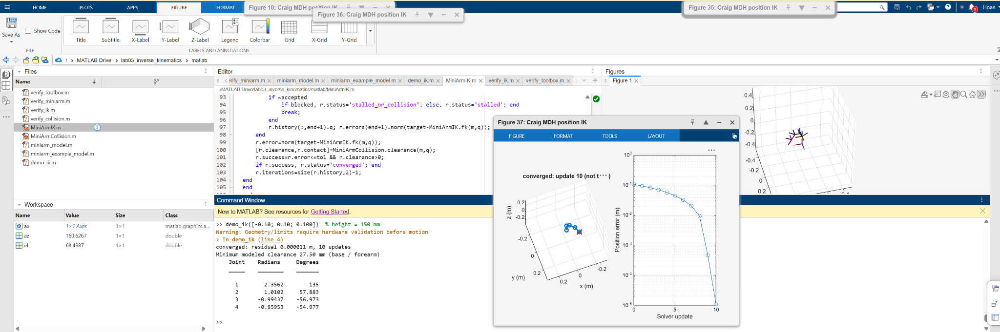
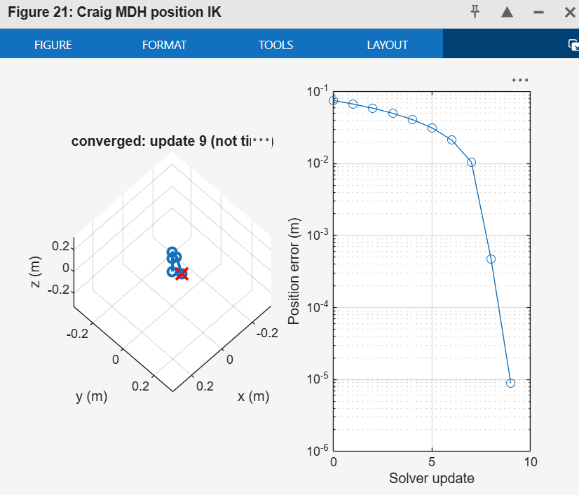
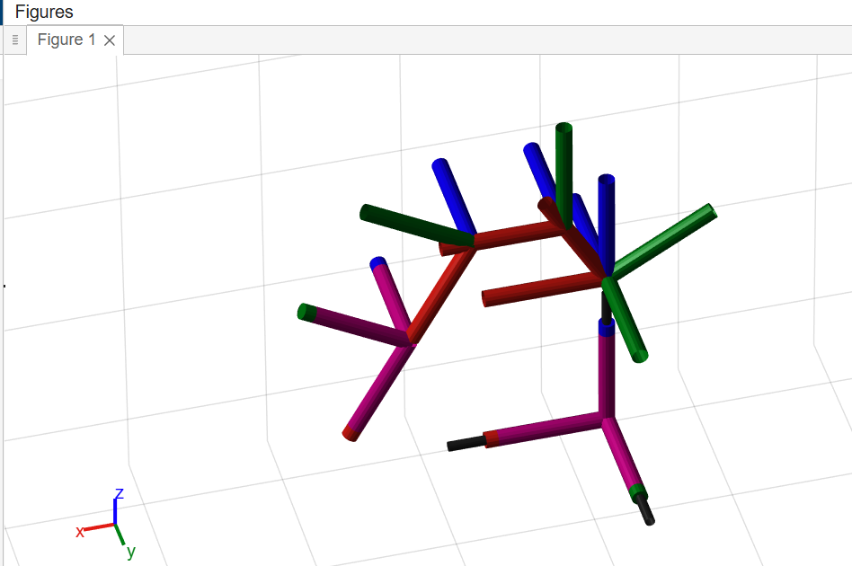

# What a working simulation looks like

These are instructor screenshots from working MATLAB sessions, provided as
visual references for students. They show different runs/views, not one fixed
answer that every submission must reproduce. Images are the original screenshots.

## 1. MATLAB Online: command, numerical results and simulation



**Figure 1.** The Command Window reports convergence, final joint angles and
positive modeled clearance. The foreground figure shows the arm reaching the
red target marker and a decreasing position-error curve.

The command visible in this screenshot is:

```matlab
demo_ik([-.10; .10; .100])
```

With the current x-right/y-forward/z-up convention, this means 100 mm left,
100 mm forward and **100 mm above the table**. The screenshot's trailing
comment says 150 mm, but the actual third argument is .100 m and determines the
height. Use `.150` if you intend 150 mm.

The illustrated run reports approximately:

| Quantity | Screenshot result |
|---|---:|
| Final position residual | 0.000011 m, or 0.011 mm |
| Accepted updates | 10 |
| Minimum modeled clearance, including configured margin | 27.50 mm |
| Base angle | 135 degrees |
| Shoulder angle | 57.883 degrees |
| Elbow angle | -56.973 degrees |
| Wrist angle | -54.977 degrees |

These are reference results from this run, not mandatory joint-angle answers.
The geometry/limits warning is expected while physical calibration is pending;
it does not by itself mean the numerical solve failed.

## 2. Close-up: final configuration and convergence curve



**Figure 2.** This is a separate successful run, viewed from a different camera
angle. In the left panel, blue lines connect frame/joint origins and the TCP;
the final TCP is close to the red x. In the right panel, the vertical axis is
position error in **metres**, on a logarithmic scale. The horizontal axis counts
accepted solver updates; it is not elapsed time. The displayed status is
`converged`.

With the supplied tolerance, success requires residual at most 1e-4 m, or
0.1 mm, and positive configured clearance. The final error in this example is
well below that tolerance. You do not have to reproduce its exact iteration
count or curve shape. The target of this separate run is not specified here;
do not assume it is the same target as Figure 1.

Changing the camera angle does not change FK, IK or the XYZ coordinate frame.
After a demo, select the left subplot and adjust its view, for example:

```matlab
ax=subplot(1,2,1);
view(ax,135,45);
```

The default view is set inside `demo_ik.m`; see the [code guide](README.md).

## 3. Optional toolbox coordinate-frame display



**Figure 3.** `verify_toolbox` builds the corresponding MathWorks
`rigidBodyTree` and displays the body frames. Red, green and blue indicate local
x, y and z axes. These coloured axes are not additional robot links or measured
collision shapes. Figure numbers depend on which figures you have opened.

This display requires Robotics System Toolbox. The main custom FK/Jacobian/IK
and stick-model animation work without it. It may appear while running
`verify_miniarm` when that optional toolbox is available; `demo_ik` itself
produces the two-panel stick-model/error figure, not this frame display.

```matlab
m=miniarm_model();
robot=verify_toolbox(m);
```

Use the frame display to inspect joint axes and frame assignment. A visually
plausible frame display alone does not verify IK convergence or collision safety.

## What to compare with your own result

- The requested XYZ uses metres and the correct world axes.
- The solver reports `converged` and `r.success` is true.
- Final position error meets tolerance; every accepted error update decreases.
- The joint angles satisfy the configured joint limits.
- The configured minimum collision clearance is positive.
- The TCP agrees with the requested XYZ; confirm numerically as well as visually.

Four positioning joints are solving for three position coordinates, so different
valid postures may reach the same target. The initial guess, limits, collision
sizes and target affect the result. Judge position accuracy and configured
constraints, not an exact match to the instructor's posture or figure number.

These screenshots demonstrate simulation/model results. They do not establish
physical reaching accuracy or account for unmodeled gripper/camera geometry.

See [the execution-flow guide](README.md#execution-flow-when-you-type-demo_ik)
for how `demo_ik` calls the solver and then animates its saved history, and the
[Jacobian walkthrough](JACOBIAN_WALKTHROUGH.md) for how each column is calculated.
