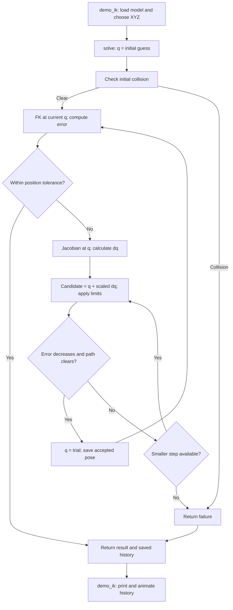

# MATLAB code guide: from DH parameters to inverse kinematics

This guide follows the latest instructor `miniarm_model.m`. The main task is
**3D XYZ position IK with four revolute joints, free claw pitch, joint limits
and approximate collision checks**. Core calculations use base MATLAB.
Robotics System Toolbox is used only by the optional independent check/display.

## 1. Coordinate and angle conventions

Viewed from behind the arm at the Arduino board and knobs, frame {0} has
**x right, y forward, z up**. This is right-handed. All MATLAB calculations use
metres and radians; convert human-entered degrees with `deg2rad`.

```matlab
q = deg2rad([base_angle; shoulder; elbow; wrist]);
```

| Variable | Meaning |
|---|---|
| q(1) | Base angle: 0 degrees right, 90 forward, 180 left |
| q(2) | Shoulder angle from horizontal: 0 horizontal, 90 upright |
| q(3) | Elbow relative angle: 0 means forearm in line with upper arm |
| q(4) | Wrist relative angle: 0 means tool in line with forearm |

Negative elbow/wrist angles bend forward/down in the chosen planar sign
convention. These are mathematical joint angles, not raw servo commands. The
claw-opening actuator is separate and is not a fifth positioning joint.

Unlike the original uploaded Python GUI's world coordinates, there is now **no
base_angle-90 conversion** in the main simulation. The base MDH offset stays
zero. The same physical point transforms from the old axes to the current axes
by `x_new=-y_old`, `y_new=x_old`, `z_new=z_old`.

## 2. Role of every .m file

| File | Main responsibility | When to edit/run |
|---|---|---|
| [miniarm_model.m](miniarm_model.m) | DH parameters, fixed base/tool transforms, limits, initial pose, default goal pose and collision geometry | Edit to describe your own miniArm |
| [MiniArmIK.m](MiniArmIK.m) | Static methods for MDH matrices, FK, position Jacobian and iterative numerical IK | Read/modify when studying or implementing the mathematics |
| [MiniArmCollision.m](MiniArmCollision.m) | Capsule distances, table clearance and interpolation checking | Read when studying collision rejection; sizes are configured in the model |
| [demo_ik.m](demo_ik.m) | Loads the model, selects an XYZ target, calls IK, prints results and animates solver updates | Main simulation entry point; edit plotting/view settings here |
| [verify_miniarm.m](verify_miniarm.m) | Checks this miniArm's reference poses, signs, partial/finite Jacobians and a reachable goal | Run after changing the main implementation; fixed reference dimensions are checked |
| [verify_collision.m](verify_collision.m) | Checks base/tool intersection, invalid seeds, intervening collisions and a clear goal | Run after changing collision or solver behavior |
| [verify_toolbox.m](verify_toolbox.m) | Builds a MathWorks rigidBodyTree, compares FK/Jacobian and shows coordinate frames | Optional; requires Robotics System Toolbox; returns `robot` |
| [miniarm_example_model.m](miniarm_example_model.m) | Separate, fixed generic robot used as a regression fixture | Leave unchanged when changing your actual miniArm model |
| [verify_ik.m](verify_ik.m) | General algorithm checks using that generic fixture, including nonzero offsets and transformed base/tool | Run to test reusable mathematics independently of the current miniArm geometry |

`MiniArmIK` and `MiniArmCollision` are classes containing **static methods**:
call `MiniArmIK.fk(...)` directly; you do not need to create a class instance.

## 3. Where the DH table is defined

In `miniarm_model.m`:

```matlab
% Each row: [a_(i-1), alpha_(i-1), d_i, thetaOffset_i]
m.mdh = [0      0       .120  0;
         0      pi/2    0     0;
         .0565  0       0     0;
         .0615  0       0     0];
m.base = eye(4);
m.tool = eye(4); m.tool(1,4) = .085;
```

| Row | Joint | a_(i-1), m | alpha_(i-1) | d_i, m | Fixed theta offset |
|---|---|---:|---:|---:|---:|
| 1 | Base | 0 | 0 | 0.120 | 0 |
| 2 | Shoulder | 0 | pi/2 | 0 | 0 |
| 3 | Elbow | 0.0565 | 0 | 0 | 0 |
| 4 | Wrist | 0.0615 | 0 | 0 | 0 |

The fourth column contains only **fixed offsets**. The changing angle is added
inside `mdh`: `theta = q(i) + m.mdh(i,4)`. All offsets in this model are zero.
The 85 mm wrist-to-tool distance is a fixed transform in `m.tool`, not another
actuated joint or an extra Jacobian column.

`m.base` maps coordinates from model frame {0} into the world/target frame.
Identity means those two frames coincide. `m.tool` maps tool-frame coordinates
into frame {4}; its translation places the TCP 85 mm along x4.

The other key fields are:

```matlab
m.limits   = deg2rad([0 180; 0 180; -160 160; -160 160]);
m.q0       = deg2rad([90;60;-60;-60]);
m.demoGoal = deg2rad([110;70;-80;-40]);
```

`q0` is the initial numerical guess. `demoGoal` is a known joint pose used to
generate the default reachable XYZ target; it is **not** an orientation
constraint or a requirement that IK return those exact joint angles.
The limits are simulation values pending physical calibration. `exampleOnly`
remains true to guard servo export until calibration is verified; it does not
prevent simulation. `m.label` is descriptive metadata.

### Frame placement behind the table

Craig modified DH assigns the rotation of joint i to **z_i**. Frame {1} is at
shoulder height on the vertical base axis; frame {2} has the same origin and a
horizontal shoulder axis. Frame {3} is at the elbow; frame {4} is at the wrist.
The x2, x3 and x4 axes follow the upper arm, forearm and tool respectively.

At base angle 90 degrees, the arm faces forward and z2 points right. The
positive 90-degree twist about x1 turns vertical z1 into this horizontal z2.
Parallel shoulder/elbow/wrist axes give zero twists in the next rows. The
distances between those parallel axes are the upper-arm and forearm lengths.
The model assumes the base and shoulder axes intersect; real additional axis
offsets must be measured and added if present.

## 4. Where each transformation matrix is calculated

**Method:** `MiniArmIK.mdh(row,q)` in `MiniArmIK.m`.

Craig's modified-DH product is:

```math
A_i=R_x(\alpha_{i-1})T_x(a_{i-1})R_z(q_i+\theta_{0i})T_z(d_i).
```

The code evaluates its expanded 4x4 matrix. Writing c=cos(theta), s=sin(theta),
ca=cos(alpha), sa=sin(alpha), it constructs:

```matlab
A = [c     -s      0     a;
     s*ca   c*ca  -sa   -d*sa;
     s*sa   c*sa   ca    d*ca;
     0      0      0     1];
```

The same method also returns `D`, the exact partial derivative of A with
respect to the joint variable **in radians**:

```matlab
D = [-s     -c      0  0;
      c*ca  -s*ca   0  0;
      c*sa  -s*sa   0  0;
      0      0      0  0];
```

Inspect an individual joint transform:

```matlab
m = miniarm_model();
q = m.q0;
[A2, dA2_dq2] = MiniArmIK.mdh(m.mdh(2,:),q(2))
```

## 5. Where forward kinematics is calculated

**Method:** `MiniArmIK.fk(m,q)` in `MiniArmIK.m`.

It starts with `T=m.base`, loops through the joints multiplying `T=T*A_i`, and
finally multiplies `T=T*m.tool`. Thus:

```math
T=T_{base}A_1A_2A_3A_4T_{tool}.
```

The resulting matrix expresses the TCP frame in the world/target frame. Its
upper-left 3x3 block is orientation and its top three entries in column 4 are
position. Orientation is calculated by FK even though the IK task constrains
only position.

```matlab
[p,T,P] = MiniArmIK.fk(m,q);
p_mm = 1000*p
T
```

| Output | Meaning |
|---|---|
| p | 3x1 TCP position [x;y;z], metres |
| T | 4x4 TCP homogeneous transformation |
| P | 3x6 frame-origin/TCP positions used for drawing and collision checks |

**With one output, `fk` returns p, not T.** Use `[~,T]` if you want just the
transformation. P columns are table origin, frame {1}, frame {2}, elbow, wrist,
TCP. The two shoulder origins coincide, so a zero-length drawing segment is
expected. Lines joining these points are kinematic representations, not CAD.

## 6. Where the Jacobian is calculated

**Method:** `MiniArmIK.jacobian(m,q,method,h)` in `MiniArmIK.m`.

The position Jacobian has 3 rows (x,y,z) and 4 columns (base, shoulder, elbow,
wrist), with units metres per radian:

```math
J=\frac{\partial p}{\partial q},\qquad \Delta p\approx J\Delta q.
```

### Exact partial derivatives: the default

```matlab
J = MiniArmIK.jacobian(m,q,'partial');
```

For column j, the code multiplies all the same transforms as FK but substitutes
the derivative `D_j` for `A_j`:

```math
\frac{\partial T}{\partial q_j}
=T_{base}A_1\cdots A_{j-1}D_j A_{j+1}\cdots A_4T_{tool}.
```

The outer loop selects which joint to differentiate. The inner loop builds this
product. `J(:,j)=dT(1:3,4)` extracts the derivative of the TCP position. This
automatically includes the tool offset and needs no Symbolic Math Toolbox.

### Finite differences: perturb one joint

```matlab
Jn = MiniArmIK.jacobian(m,q,'finite',1e-5);
norm(J-Jn,'fro')
```

For each column the code constructs a vector with h at that joint and zero
elsewhere, calls FK at q+dq and q-dq, and divides their position difference by
2h. The perturbation h is in radians. This approximates the same partial
derivative and provides a useful check of the exact implementation.

## 7. Where numerical IK is calculated

**Method:** `MiniArmIK.solve(m,target,q0,method)` in `MiniArmIK.m`.

```matlab
target = [-.040; .100; .150]; % 40 mm left, 100 mm forward, 150 mm up
[q,r] = MiniArmIK.solve(m,target,m.q0,'partial');
rad2deg(q)
r.status
1000*r.error                 % final position error in mm
```

The method validates inputs and rejects an initially colliding pose. Each
iteration then:

1. Calls FK and computes `e=target-p`.
2. Stops successfully if error is at most 1e-4 m (0.1 mm) and clearance is valid.
3. Calls the position Jacobian at the current q.
4. Computes the damped least-squares update:

   ```matlab
   dq = J' * ((J*J' + lambda^2*eye(3)) \ e);
   ```

   Here `lambda=.01`. MATLAB's backslash solves the 3x3 system without forming
   an explicit inverse. The 4x1 dq is in radians.
5. Limits the total update norm to 0.10 rad and projects trial angles into limits.
6. Tries progressively smaller steps using `0.5^ls`. A step is accepted only if
   its actual nonlinear XYZ error decreases and its joint interpolation passes
   the configured collision check.
7. Stores accepted angles/errors and repeats, up to 400 updates.

There is **no claw-pitch error row**. Four joints for three coordinates generally
allow different postures. The initial guess influences the result. Hard
collision rejection can also stall a local search even if another route exists.

| Result field | Meaning |
|---|---|
| r.success | True only when final XYZ tolerance and configured clearance pass |
| r.status | converged, max_iterations, stalled, stalled_or_collision, or seed_in_collision |
| r.error | Final XYZ distance error in metres |
| r.history | Joint vectors as columns; first column is the seed |
| r.errors | Position error at each stored joint vector |
| r.iterations | Number of accepted updates |
| r.clearance | Minimum signed clearance in metres, including configured margin |
| r.contact | Limiting pair/table check; not necessarily an actual contact if clearance is positive |

An unsuccessful solve returns its last iterate for diagnosis; it is not a valid
target solution and must not be sent to servos as one.

## 8. Collision calculations

`MiniArmCollision.clearance(m,q)` calls FK, turns selected P columns into line
segments, thickens them by configured capsule radii, and checks selected link
pairs and the table. Positive clearance means those approximations are separated.
`edgeClear` checks the continuous straight joint interpolation using a travel
bound and recursive subdivision, failing closed when it cannot establish
clearance. It does not merely check the final pose.

The radii, pair list, margin and table height live in `m.collision` in the model.
They are provisional simulation values. See [COLLISIONS.md](../COLLISIONS.md)
for their limits and why a different hardware execution path must be checked
separately. Collision checks do not change the position Jacobian formula.

## 9. Demo, toolbox figure and verification

### Execution flow when you type demo_ik

1. MATLAB enters `demo_ik.m`, calls `miniarm_model()` and validates the model.
2. If you typed only `demo_ik`, it computes `target=FK(m.demoGoal)`. If you typed
   `demo_ik([x;y;z])`, that supplied XYZ is the target. The default goal pose
   supplies a known-reachable position; its joint angles are not the IK answer.
3. It calls `MiniArmIK.solve(m,target,m.q0,'partial')`. The solver sets
   `q=m.q0` and rejects an initially colliding configuration.
4. The solver runs its outer numerical loop: FK -> position error -> convergence
   check -> Jacobian at the same current q -> damped joint update -> candidate
   acceptance, as detailed below.
5. After the solver finishes, it returns the final q and the result structure r.
   `demo_ik` prints status, residual, clearance and angles.
6. Only then does `demo_ik` create its figure and replay `r.history` using FK.
   This second loop is animation, not another IK solve. The red x is the
   target; the error curve comes from `r.errors`. An unsuccessful solve is
   displayed for diagnosis and is labelled with its failure status.



The solver also stops at 400 outer iterations and performs a final success
check. The diagram omits that iteration-limit branch for readability.

### Where the joint update is added

The basic numerical IK idea is `q_next=q+dq`. Our implementation first makes a
**candidate** and only commits it after checking the actual nonlinear FK and
collision constraints. In `MiniArmIK.solve`, the steps now appear explicitly:

```matlab
stepScale = .5^ls;
qCandidate = q + stepScale*dq; % add update to CURRENT joint vector
trial = min(max(qCandidate,m.limits(:,1)),m.limits(:,2));
trialError = norm(target-MiniArmIK.fk(m,trial));

if trialError < norm(e)-1e-12
    if MiniArmCollision.edgeClear(m,q,trial)
        q = trial;           % accept this as the NEW current joint vector
        accepted = true;
        break;               % exit the INNER loop, not the outer IK loop
    end
end
```

`qCandidate=q+stepScale*dq` is the addition you were looking for. Previously,
that same addition was nested inside the single line
`trial=min(max(q+(.5^ls)*dq,...),...)`; it was not missing.

| Variable | Meaning during one outer iteration |
|---|---|
| q | Current accepted joint vector; unchanged while trying smaller candidates |
| e | Target minus FK(q), evaluated before the candidate search |
| J | Jacobian evaluated at that same q |
| dq | Damped joint update, with its total norm limited to 0.10 rad |
| stepScale | 1, 1/2, 1/4, ... down to 1/32768 |
| qCandidate | q plus the scaled joint update, before joint-limit projection |
| trial | Candidate after applying joint limits |
| trialError | Actual XYZ error from FK(trial) |

### Why q = trial is conditional

The Jacobian predicts small changes through `delta_p approximately J*dq`.
The full FK is nonlinear. Damping and a small update help, but a full candidate
can still increase the true error, hit a collision, or be altered by joint-limit
projection. Accepting every proposed update is not guaranteed to make progress.

The code therefore tries the full limited dq first (`ls=0`). If it fails, it
tries half, quarter, and successively smaller updates, always starting from the
same accepted q. It accepts the first candidate that reduces the actual error
and has a clear configured interpolation path.

The `1e-12` in the error comparison is a tiny required error decrease in metres,
not the convergence tolerance. The convergence tolerance is `tol=1e-4` m.

For a simple arithmetic example, suppose the current angles in DEGREES are
`[90;60;-60;-60]` and the already-limited update is `[2;-1;3;-2]` degrees. The
first candidate is `[92;59;-57;-62]`. If rejected, the half-step candidate is
`[91;59.5;-58.5;-61]`. If that candidate passes both checks, q is assigned that
half-step result. Actual implementation uses radians throughout.

After acceptance, the solver saves q and continues the **outer** loop. It now
recomputes FK, e and J using the newly accepted q. The next iteration does not
reuse the old error or old Jacobian. If all 16 step scales fail, it stops with
`stalled` or `stalled_or_collision`; it does not loop forever with unchanged q.
No acceptable decreasing step is a local-search failure, not a proof that no
collision-free configuration exists.

### Plot settings and optional toolbox display

The animation steps are numerical updates, not a timed servo trajectory.

The call `view(ax,40,25)` inside the animation loop sets its viewing direction.
You can replace it with `view(ax,135,45)` or your preferred measured camera
angles. Change `m.q0` for the initial pose; enter XYZ for the goal:

```matlab
demo_ik
demo_ik([-.040; .100; .150])
```

`verify_toolbox` constructs a separate `rigidBodyTree` from the same MDH rows,
base transform and tool transform. Its tests compare `getTransform` with our FK
and rows 4:6 of `geometricJacobian` with our position Jacobian. This reference
does not replace our IK solver. It also opens the coloured-frame figure.

MathWorks ignores a revolute joint's theta entry in `setFixedTransform`.
The adapter therefore uses zero in that column and passes `q+m.mdh(:,4)` as
the toolbox configuration; this preserves nonzero offsets. All current offsets
are zero, so toolbox and custom q happen to match.

```matlab
robot = verify_toolbox(m);
q = deg2rad([90;60;-60;-60]);
figure;
show(robot,q+m.mdh(:,4),'PreservePlot',false);
```

`show` is a display command; it does not enforce our collision checks. The red,
green and blue axes denote local x,y,z, rather than physical link thicknesses.

Suggested verification sequence after refreshing the files in MATLAB Online:

```matlab
clear classes
verify_miniarm
verify_collision
verify_ik
demo_ik
```

`verify_ik` uses the separate generic example robot. Its different lengths,
negative shoulder twist and base-angle range do not override your miniArm model.
`verify_miniarm` checks fixed instructor dimensions; adapt expected values if you
deliberately change those dimensions. The default miniArm model remains the
one used by `demo_ik` and by `verify_toolbox` with no arguments.

## 10. What is not done by these .m files

They do not send serial commands, calibrate servo values, model motor torque,
read joint encoders or control claw opening. They are the mathematical and
simulation stage before the calibrated hardware interface. MATLAB verification
scripts are provided for local execution; Python cross-checks alone do not
establish that these .m scripts have executed successfully on every release.
